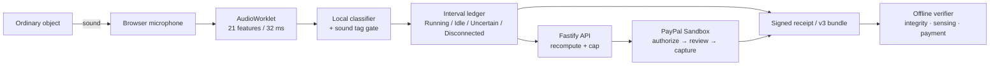

# Whirr 4.0 — three-minute demo

**Narrative:** ordinary object → sound tag → live meter → PayPal boundary → receipt you can check.  
**Claim boundary:** the checked-in model is synthetic. A live microphone demo is not Gate A unless it is three genuine, reviewed ON/OFF trials on a physical object. Gate A and Gate E remain OPEN.

**4.1 addition:** the Real-World Calibration Lab is the guided path for a physical object. It records live enrollment, trains locally, runs a three-cycle protocol plus noise/distance/replay trials, and refuses to publish a live-calibrated model without a passing report. It is not run in this checkout; see [`docs/field-test.md`](field-test.md).

## Before recording

1. Run `npm run setup && npm run dev`.
2. Open:
   - `/` — landing;
   - `/shelf` — the bench;
   - `/s/obj_reference_fan` — the demo bench card;
   - `/judge` — gates and evidence;
   - `/verify` — Tamper Lab;
   - `/proof/:id` — the latest proof if one exists.
3. Check the browser console is clean.
4. Keep the operator key and `.env` out of frame.
5. Use the official PayPal Sandbox checkout only. Never show a mock PayPal screen, a fabricated capture ID or a real payment.
6. If using a physical tool, place its microphone where the object will run and label the object as the actual device. Do not use imported audio as if it were live.

## Physical setup

- One ordinary motorised object with a repeatable sound (fan, drill, sander, blender, compressor).
- One laptop or phone with a microphone.
- One phone or second browser profile for the renter view; a second profile avoids cookie confusion.
- The object’s service card open at `/s/<objectId>`.
- PayPal Sandbox seller configured; a Sandbox buyer account ready for approval.
- A quiet room and a visible object. Do not hide the fact that the tool is unmodified.
- Fallback: the synthetic reference fan at `/demo/offline` and a clearly labelled demo session.

## Three-minute script

### 0:00–0:15 — The problem

**Visual:** landing hero, then the bench card.

> “Shared workshops own useful tools, but not a good way to charge for twenty minutes of use. A clock bills the setup. A lock is expensive. A clipboard is a promise. Whirr turns the tool itself into the meter — just by listening.”

### 0:15–0:45 — The unexpected interaction

**Visual:** scroll from the bench ticket to the tool card. Point at the sound tag.

> “This fan has no new hardware. It has a sound tag: eight bands learned from its own running noise. The renter sees the rate, the ceiling and the calibration age before touching anything. The object stays ordinary.”

Open the bench card. Point at `$0.20 per running minute`, `$5.00` cap and `Sandbox only`.

> “The renter is not buying an hour. They are authorizing a ceiling, then paying for the minutes Whirr can defend.”

### 0:45–1:20 — PayPal boundary

**Visual:** consent checkbox, authorize action, PayPal Sandbox approval, return to the session.

> “PayPal is the handshake, not a badge. The cap is authorized before the microphone opens. The page cannot start sensing until the authorization is verified. When the session stops, the renter reviews the quote and only then can the capture happen.”

If a Sandbox buyer is unavailable, stop and say:

> “This is the demo metering path. No PayPal order, authorization or charge exists.”

Do not imply that a demo receipt is a PayPal transaction.

### 1:20–1:55 — Listening Room

**Visual:** start sensing, run the tool ON, then OFF. Show the state word, radial field, spectral trace and provisional quote.

> “The field is the actual eight-band signal, not an animation. When the motor is confidently recognised, the state is Running and the provisional bill grows. When it stops, the state is Idle and the bill stays still. If the sound is ambiguous or does not match the object profile, it becomes Uncertain and is free.”

Show `Uncertain` or a mismatch if it occurs naturally. Do not stage a fake failure.

> “The microphone is open only on this page. Hiding the tab pauses sensing. The raw audio never leaves the browser.”

### 1:55–2:25 — Stop, review, prove

**Visual:** stop, review the interval ledger, accept the quote, open the receipt.

> “These are the intervals behind the number. Every billed segment can be inspected. The receipt pins the rate, cap and terms; the quote recomputes from evidence; the payment state is the provider’s state, not a UI claim.”

Open the proof bundle.

> “The receipt is signed. A stranger can verify the bytes offline. The proof separates three claims: integrity, sensing and payment. Integrity is checkable here. Sensing is a signed client claim, because a microphone cannot prove the physical object was present. Payment needs the provider.”

### 2:25–2:50 — Failure is part of the product

**Visual:** Tamper Lab, edit one interval or the amount; show rejection. Then show the gates page.

> “Change a byte and verification fails. That is the useful part. And the gates page keeps the uncomfortable claims open: real-object trials, a genuine public webhook, a public submission and comprehension testing.”

### 2:50–3:00 — Close

**Visual:** bench page, then proof card.

> “Whirr Bench makes an ordinary tool a pay-per-use service without modifying it. The meter is acoustic and bounded; the receipt says exactly what it can and cannot prove. That is the invention: usage becomes a legible, payable, portable fact.”

## Shot list

| Time | Shot | Must show |
| --- | --- | --- |
| 0:00 | Landing hero | Product name and promise |
| 0:10 | Bench card | Rate, cap, sound tag |
| 0:25 | Consent | Sandbox-only banner and authorization language |
| 0:40 | PayPal | Official Sandbox UI, or a clearly labelled demo state |
| 1:00 | Listening Room | Object, state word, field, provisional quote |
| 1:20 | ON/OFF transition | Running then Idle; bill moves/does not move |
| 1:40 | Free uncertainty | `Uncertain` or mismatch explanation, if it occurs |
| 1:55 | Review | Interval ledger and reviewed quote |
| 2:10 | Receipt | Quote, cap, payment state |
| 2:25 | Proof | Trust domains and offline verification |
| 2:35 | Tamper rejection | Changed byte fails |
| 2:50 | Gates | A/E/F/G still OPEN |

## Backup demonstration

Use this only if the microphone, object, network or Sandbox is unavailable:

1. Say: “This is the synthetic reference fixture and demo metering, not a physical measurement or a Sandbox payment.”
2. Open `/demo/offline`; show the labelled replay and its known provenance.
3. Open the demo receipt; show `DEMO_NO_PAYMENT`.
4. Run the Tamper Lab.
5. Leave the gates page visible with A/E/F/G still OPEN.

Never replace the fallback with a fabricated live result.

## Architecture at demo speed

## Submission explanation

Whirr’s defensible claim is not that a microphone knows physical truth. It is that a **bounded acoustic claim can be made legible, payable and portable**:

- local inference keeps raw audio off the network;
- uncertainty is a free state, so the bill is conservative;
- integer pricing and a consented cap make the money rule auditable;
- PayPal provides the permission boundary and the payment state;
- signed interval evidence lets a stranger verify the arithmetic and the bytes.

The demo should make the boundary feel like craftsmanship, not a disclaimer.

## Real-World Calibration Lab (4.1, physical)

Do not put this segment in a recorded run unless a physical appliance is actually present. If it is, use a new object (not the synthetic reference fan):

1. Open `/studio/objects/<objectId>/calibration-lab`.
2. Record two idle, two operating and one background take with the computer’s microphone. Show that the trace only moves while the microphone is open and that the page returns to `MIC CLOSED` afterwards.
3. Train the model and show the live model status. Do not call the training metrics field accuracy; they are leave-one-take-out.
4. Run the guided three-cycle trial, following the ON/OFF prompts. Then run the noise, distance and replay trials. If the replay trial fails, say so; do not edit it out.
5. Generate the report and open `/field-report/<id>`. Show the model hash, the gates, the measured false-billable time and the limitations. Then publish terms and open the Listening Room only if the report says `FIELD_PASS`.

If the physical test is not available, show the lab in its microphone-closed state and state plainly that the field test is pending.
